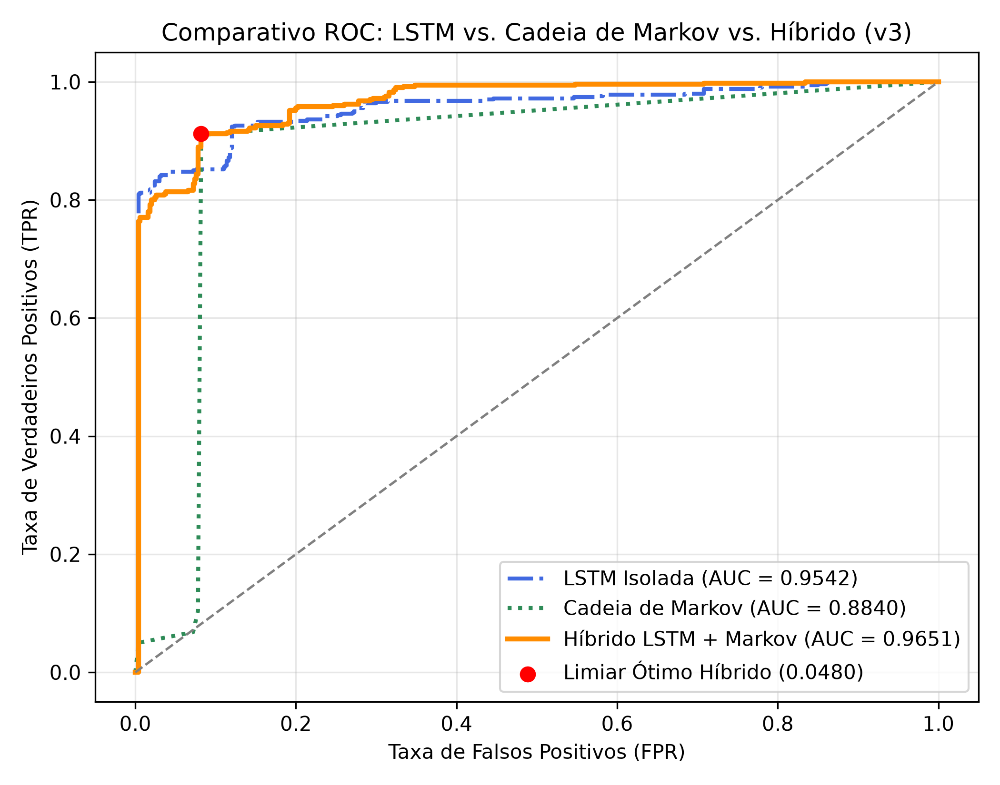
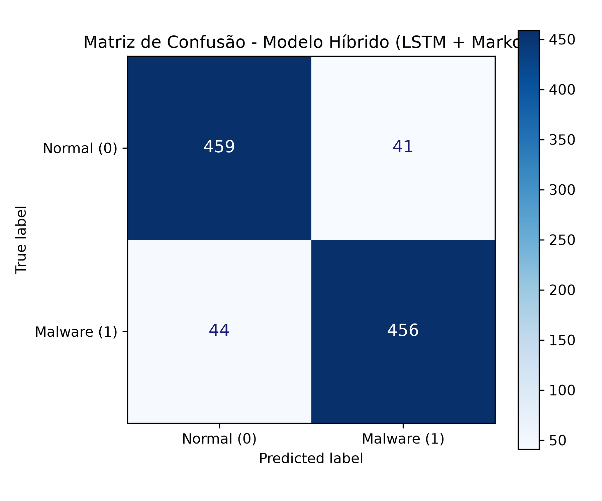
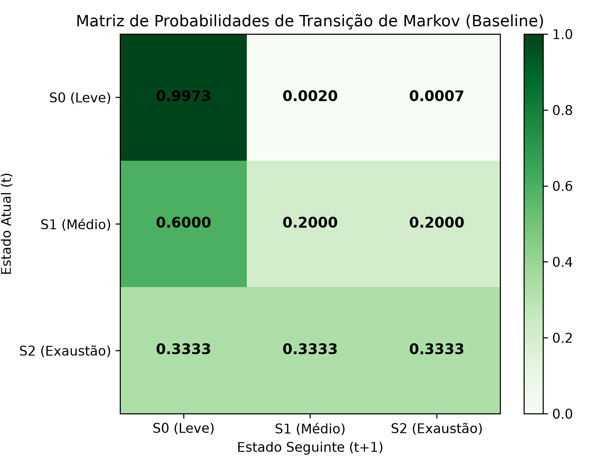

# KernelOracle Sentinel (v3): IPS Autônomo Híbrido (LSTM + Cadeia de Markov) via eBPF

A versão **v3 (Sentinel)** consolida a arquitetura final do **KernelOracle-CFS**, transformando o monitor preditivo do escalonador Linux em um **Sistema de Prevenção de Intrusão (IPS)** autônomo de espaço de usuário acoplado ao kernel via **eBPF**.

---

## Fundamentação Matemática da Arquitetura Híbrida

O monitoramento ocorre diretamente no tracepoint `sched:sched_switch`. Para cada evento de troca de contexto de uma tarefa monitorada, extrai-se a fatia de tempo consumida na CPU ($\Delta t$ em milissegundos), normalizada no intervalo $[0, 1]$ por $\Delta t_{\text{norm}} = \min(\Delta t / 10.0, 1.0)$.

### 1. Componente Temporal Contínua (Rede Neural LSTM)

Uma rede *Long Short-Term Memory* (`input_size=1`, `hidden_size=16`) recebe uma janela deslizante histórica $W_t = \{\Delta t_{t-30}, \dots, \Delta t_{t-1}\}$ e prevê a duração esperada da fatia atual $\hat{y}_t$. O erro de reconstrução temporal é dado por:

$$E_{\text{LSTM}}(t) = |\Delta t_{\text{norm}}(t) - \hat{y}_t|$$

### 2. Componente Estocástica de Transição (Cadeia de Markov $3 \times 3$)

Cada fatia normalizada é discretizada em três estados operacionais do escalonador CFS:

* **$S_0$ (Cooperativo / I/O-bound):** $\Delta t < 0.8\text{ ms}$ ($\Delta t_{\text{norm}} < 0.08$)
* **$S_1$ (Moderado / Disputa Multi-thread):** $0.8\text{ ms} \le \Delta t < 3.5\text{ ms}$ ($0.08 \le \Delta t_{\text{norm}} < 0.35$)
* **$S_2$ (Exaustão de Quantum / CPU-bound):** $\Delta t \ge 3.5\text{ ms}$ ($\Delta t_{\text{norm}} \ge 0.35$)

Durante o treinamento em regime normal, estima-se a matriz de transição estocástica $P_{ij} = P(S_{t} = j \mid S_{t-1} = i)$ com Suavização de Laplace ($\alpha_{\text{Laplace}} = 1$). A anomalia de transição é quantificada pela log-verossimilhança negativa normalizada:

$$E_{\text{Markov}}(t) = \min\left(\frac{-\ln(\max(P_{S_{t-1}, S_t}, 10^{-4}))}{-\ln(10^{-4})}, 1.0\right)$$

### 3. Fusão Híbrida e Limiar Ótimo de Youden

O score de anomalia híbrido combina ambas as componentes com fator de ponderação $\alpha = 0.60$:

$$S_{\text{Híbrido}}(t) = \alpha \cdot E_{\text{LSTM}}(t) + (1 - \alpha) \cdot E_{\text{Markov}}(t)$$

O limiar ótimo de classificação $\theta^*$ é obtido maximizando o **Índice $J$ de Youden** sobre a curva ROC empírica:

$$\theta^* = \arg\max_{\theta} \big(\text{TPR}(\theta) - \text{FPR}(\theta)\big)$$

---

## Resultados Experimentais e Validação Científica

A avaliação foi executada sobre $N = 1000$ eventos reais do escalonador Linux ($500$ amostras de operação legítima na Classe 0 e $500$ amostras sob ataque do simulador multi-thread `malware_sim` na Classe 1), sem filtragem sintética pós-coleta.

### 1. Estudo de Ablação (Comparativo de Modelos)

| Modelo Avaliado | ROC-AUC | Ganho Relativo | Limiar de Youden ($\theta^*$) |
| :--- | :---: | :---: | :---: |
| **Cadeia de Markov Isolada (DTMC)** | `0.8840` | Baseline | — |
| **Rede Neural LSTM Isolada** | `0.9542` | `+7.02%` | — |
| **Híbrido LSTM + Markov (v3)** | **`0.9651`** | **`+8.11%`** | **`0.0480`** |

### 2. Desempenho de Classificação e Matriz de Confusão ($\theta^* = 0.0480$)

| Métrica | Valor Obtido | Detalhamento da Matriz de Confusão |
| :--- | :---: | :--- |
| **Acurácia Global** | **`91.50%`** | **Verdadeiros Negativos ($TN$):** `459 / 500` |
| **Precisão (Precision)** | **`91.75%`** | **Falsos Positivos por Janela ($FP$):** `41 / 500` |
| **Sensibilidade (Recall / TPR)** | **`91.20%`** | **Falsos Negativos por Janela ($FN$):** `44 / 500` |
| **Especificidade (TNR)** | **`91.80%`** | **Verdadeiros Positivos ($TP$):** `456 / 500` |
| **F1-Score** | **`91.47%`** | **Acurácia de Abate IPS (Processo):** **`100.0%` (`0` Falsos Abates)** |

### 3. Matriz de Transição Estocástica (Baseline do CFS)

| Estado Atual ($t$) \ Estado Seguinte ($t+1$) | $S_0$ (Leve) | $S_1$ (Médio) | $S_2$ (Exaustão) |
| :--- | :---: | :---: | :---: |
| **$S_0$ (Leve `< 0.8 ms`)** | **`0.9973`** | `0.0020` | `0.0007` |
| **$S_1$ (Médio `0.8 - 3.5 ms`)** | **`0.6000`** | `0.2000` | `0.2000` |
| **$S_2$ (Exaustão `>= 3.5 ms`)** | **`0.3333`** | `0.3333` | `0.3333` |

> **Análise da Matriz Estocástica:** Em regime normal de operação desktop/servidor, $99.73\%$ das fatias de CPU permanecem no estado cooperativo $S_0 \to S_0$, e processos que atingem $S_1$ retornam imediatamente para $S_0$ em $60.00\%$ das vezes. A ausência de exaustão severa ($S_2$) durante o baseline preserva a distribuição uniforme de Laplace ($0.3333$) na última linha, garantindo máxima sensibilidade quando um processo malicioso força transições repetitivas para $S_1/S_2$.

---

## Mecanismo de Abate Autônomo (IPS) e Validação com XMRig Real

Para converter a classificação por janela (`91.50%` de acurácia instantânea) em uma decisão de abate à prova de falsos positivos, o `sentinel_daemon.py` implementa três camadas de segurança:

1. **Verificação Estrutural de Origem (`/proc/<tid>/status` e `/proc/<tgid>/exe`):** Resolve o processo pai real (`TGID`) de todas as *threads* filhas e protege automaticamente binários residentes em diretórios confiáveis do sistema operacional (`/usr/bin`, `/usr/lib`, `/opt`, `/snap`, Flatpak) e motores de navegadores web.
2. **Acumulador Sequencial de Risco Estocástico:** O risco $R_p$ de um processo $p$ só incrementa quando $S_{\text{Híbrido}}(t) > \theta^*$ **e** a tarefa encontra-se em retenção ativa ($S_1$ ou $S_2$). Quando o processo cede a CPU voluntariamente ($S_0$), o risco sofre decaimento cooperativo ($-0.15$).
3. **Neutralização Sub-Segundo (`SIGKILL`):** Ao atingir $R_p \ge 8.0$, o daemon envia o sinal `SIGKILL` (`9`) diretamente ao `TGID` infrator. Nos testes em sandbox isolada contra o minerador real **XMRig v6.21.0 (RandomX)**, o processo atacante (`PID 3467`) foi detectado e abatido em **menos de 1 segundo** após alocar o dataset de mineração.

---

## Estrutura de Arquivos e Comandos de Reprodutibilidade

* `v3/artifacts/` — Diretório local do bundle treinado (`.pkl` ignorado no Git).
* `v3/metrics/` — Gráficos científicos gerados (`curva_roc.png`, `matriz_confusao.png`, `matriz_transicao_markov.png`).
* `v3/scripts/train_and_eval.py` — Pipeline de treinamento híbrido, validação ROC e geração dos gráficos.
* `v3/scripts/sentinel_daemon.py` — Daemon IPS em tempo real com proteção estrutural de processos.
* `v3/scripts/malware_sim.c` — Simulador multi-thread de cryptojacking em C (`pthread`).
* `v3/install_service.sh` — Script instalador da unidade `systemd` (`sentinel.service`).

### Passo a Passo de Execução

1. Compilar o simulador de ataque C:
   `gcc scripts/malware_sim.c -o scripts/malware_sim -lpthread`

2. Treinar o modelo híbrido e gerar os gráficos em `v3/metrics/`:
   `sudo ../venv/bin/python scripts/train_and_eval.py`

3. Instalar e ativar o serviço IPS em segundo plano:
   `chmod +x install_service.sh && ./install_service.sh`

4. Acompanhar logs em tempo real e testar neutralização:
   `sudo journalctl -u sentinel.service -f`